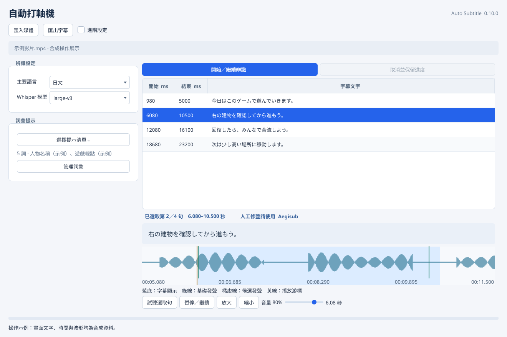
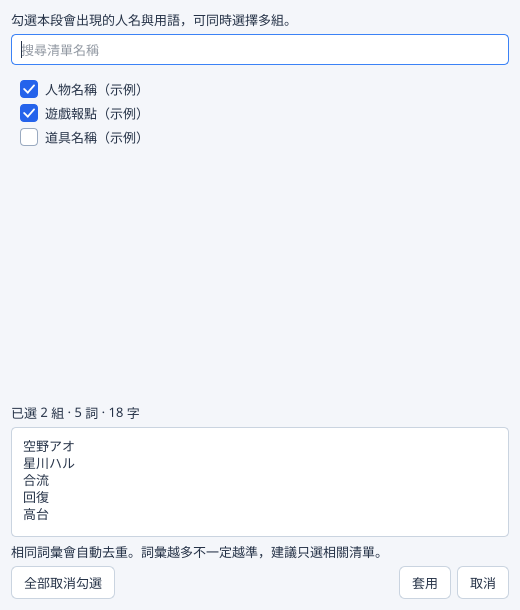
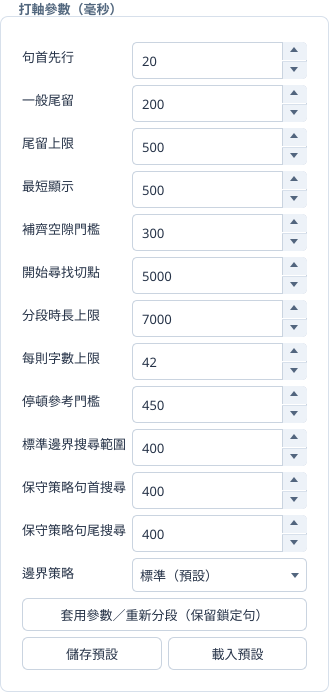

# 自動打軸機 · Auto Subtitle

將直播剪輯、影片或音檔轉成可供 Aegisub 使用的字幕時間軸。

自動打軸機是一款在電腦本機執行的字幕工具，以日文、中文、英語與韓文素材為主要使用情境。匯入媒體後，即可辨識原語文字、產生字幕軸、逐句試聽，最後匯出 **ASS／SRT**，接續翻譯與人工校正工作。

**匯入媒體 → 選擇語言與模型 → 勾選詞彙提示 → 生成與試聽 → 匯出字幕 → Aegisub 校正**

目前版本：**0.10.1**。一般使用者可直接使用 Release 可攜版，無須安裝 Python 或自行編譯。



*以下操作圖片使用合成文字、時間與波形，供介面說明使用，並非辨識品質展示。*

## 主要功能

- **影片與音檔匯入**：透過 FFmpeg 處理常見媒體格式，並可選擇要辨識的音軌。
- **中、英、日、韓語音辨識**：使用 Whisper 系列模型，提供 CPU 與相容 NVIDIA GPU 的本機運算方式。
- **字幕分段與打軸**：結合辨識結果、語音活動偵測與分段規則，調整句首先行、尾留、最短顯示時間及短空隙銜接。
- **多組詞彙提示**：可同時勾選人名、遊戲術語等清單，預覽合併內容並自動去重；清單可自行建立、修改與重複使用。
- **字幕預覽與逐句試聽**：選句後可查看完整文字與波形，僅播放該字幕軸的時間範圍。
- **ASS／SRT 匯出**：可交由 Aegisub 或其他相容字幕工具繼續處理。
- **保存辨識進度**：取消時保留已完成的辨識批次，可在目前工作階段繼續處理。

## 下載與安裝

前往本專案的 **Releases** 頁面，選擇適合電腦的 Windows 可攜版。請下載、解壓縮**整個套件**，不要只取出單一 `.exe`。

| 版本 | 使用情境 | 運算方式 |
| --- | --- | --- |
| CPU 版 `AutoSubtitle` | 沒有相容 NVIDIA 顯示卡，或使用 CPU 運算 | CPU／INT8 |
| GPU 版 `AutoSubtitle-GPU` | 使用相容的 NVIDIA 顯示卡 | CUDA／FP16，也可選 CPU |

解壓縮後，開啟資料夾內與版本名稱相符的 `.exe`，例如 `AutoSubtitle-0.10.1.exe` 或 `AutoSubtitle-GPU-0.10.1.exe`。請將 `_internal` 與程式保留在一起；GPU 版還需保留 `cuda` 資料夾。

如果使用的是包含原始碼與本機建置成品的專案目錄，也可以透過根目錄的 `Start-AutoSubtitle.cmd` 啟動已建置版本。

### 系統與模型需求

- **作業系統**：目前已在 Windows 11 驗證；Windows 10 實機相容性尚待確認。macOS 目前不提供可攜版。
- **GPU**：CUDA 模式需要相容的 NVIDIA 顯示卡與驅動。GPU 可攜版附帶 CUDA／cuDNN 執行庫，仍需安裝相容驅動。
- **模型下載**：模型不隨可攜版附送。首次使用選定模型時需連網下載，請預留模型快取空間。
- **離線使用**：模型完整下載後，可在本機辨識；也可從進階設定選用本機 CTranslate2 模型資料夾。
- **記憶體與顯示記憶體**：需求隨模型大小與運算裝置而異，請依電腦資源選擇模型。

## 開始使用

### 1. 匯入影片或音檔

按「匯入媒體」選擇檔案。主要操作情境為 **1–20 分鐘的單檔直播剪輯**，這不是強制的檔案時長上限。

常見輸入包括 MP4、MKV、MOV、MP3、WAV、FLAC 等；實際能否讀取取決於檔案使用的編碼與 FFmpeg 支援情況。多音軌素材可在「進階設定」中選擇音軌。

### 2. 選擇語言、模型與裝置

選擇素材的主要語言及辨識模型。模型選單提供 `tiny`、`base`、`small`、`medium`、`large-v3` 與 `turbo`，不同模型在處理時間、資源需求與辨識結果上會有差異。

使用 CPU 版時選擇 `cpu`；使用 GPU 版且電腦具備相容 NVIDIA 顯示卡時，可在「進階設定」將運算裝置設為 `cuda`。混語、遊戲音效與多人重疊發話仍可能影響辨識結果。

### 3. 勾選需要的詞彙提示

按「選擇提示清單…」，勾選本段可能出現的人名與用語。例如一段遊戲聯動剪輯，可以同時勾選：

- 主播與參與者名稱。
- 遊戲報點與戰術用語。
- 武器、角色或道具名稱。

確認下方的合併預覽後按「套用」。相同詞彙會去重，取消則不變更原有提示。搜尋清單時，已勾選但暫時未顯示的項目仍會保留。



「管理詞彙」可建立清單、逐行新增單詞、修改或刪除。儲存清單後，再回到選擇視窗勾選使用。程式會保留先前的組合；若來源清單已變更而無法重現原提示，會保留原文快照，避免默默改寫內容。

提示內容較長時會顯示提醒，建議只勾選與當段素材有關的清單。詞彙提示是辨識輔助，不是強制更正規則，也不保證勾選越多就越準。中文譯義對照可供翻譯參考，不應整份混入日文辨識提示。

### 4. 生成字幕與試聽

按「開始／繼續辨識」，選擇專案儲存位置，等待字幕生成。需要中止時可使用「取消並保留進度」，已完成的辨識批次會保存。

選取字幕後，可檢視完整文字與波形；按「試聽選取句」播放該句開始到結束的時間，不額外延伸前後內容。

- `F5`：暫停／從目前位置繼續播放。
- `Ctrl` + `↑`／`↓`：切換字幕句子。
- 下方音量控制可調整音量；「進階設定」可選擇音訊輸出裝置。

字幕表以預覽與試聽為主，最終文字校正與人工修軸可在 Aegisub 完成。

### 5. 匯出字幕

按「匯出字幕」，選擇 **ASS** 或 **SRT** 格式與儲存位置，再將字幕載入 Aegisub 進行聽辨、翻譯及校正。

匯出時會在同一資料夾產生 `字幕.ass.review.txt`（SRT 則為 `字幕.srt.review.txt`），列出短於設定時長、過長、空白、待確認標記與時間重疊群組。報告使用匯出後的時間精度與字幕序號，並記錄字幕 SHA256，方便確認是否為同一版本。重疊可能是同時發話，短軸也可能受鄰句限制；報告只提醒檢查，不修改字幕，也不代表辨識或翻譯已校正。

ASS／SRT 預設不自動插入兩行換行；需要時可在「進階設定」啟用。

## 可調整的打軸參數

「進階設定」提供下列類型的參數：

| 參數 | 作用 |
| --- | --- |
| 句首先行 | 讓字幕在估計語音開始前提早顯示 |
| 一般尾留、尾留上限 | 控制語音結束後的字幕保留時間 |
| 最短顯示 | 調整短句的顯示時間，仍受相鄰字幕與媒體邊界限制 |
| 補齊空隙門檻 | 在規則允許時，銜接間隔較短的相鄰字幕 |
| 分段時長、每則字數上限 | 控制字幕長度與分段目標 |



新建日文專案以 Whisper 原生句界為基礎，過長或字數過多時再細分。舊專案保留原有策略。

「套用參數／重新分段」會使用**已辨識的詞級資料**調整分段與顯示時間，不會重新呼叫模型產生字幕文字。完整規則與衝突處理方式見 [打軸規格](docs/timing-rules.md)。

## 使用的主要模組

| 模組 | 在本專案中的用途 |
| --- | --- |
| **PySide6／Qt** | Windows 圖形介面、字幕表、波形繪製與音訊播放 |
| **faster-whisper／Whisper** | 語音辨識，產生原語文字與時間資訊 |
| **CTranslate2** | 辨識模型的推論執行，支援 CPU／INT8 與 CUDA／FP16 |
| **Silero VAD** | 偵測語音活動區間，輔助辨識範圍與時間邊界處理 |
| **FFmpeg／imageio-ffmpeg、PyAV** | 媒體解碼、音軌讀取與辨識用音訊準備 |
| **SudachiPy／SudachiDict-core、BudouX** | 日文詞語與分段候選分析，輔助字幕切分 |
| **NumPy** | 音訊樣本與波形資料處理 |
| **PyInstaller** | 將程式與執行依賴打包為 Windows 可攜版 |

語音辨識在本機執行，素材不需上傳至雲端辨識服務。模型下載與各模組依照各自的來源與授權提供；可攜版中的第三方授權聲明請保留。

## 使用注意事項與資料保存

本工具產生的是供後續處理的字幕初稿，預設保留辨識原文，不自動翻譯或潤稿。專有名詞、輕聲、笑聲、背景音樂與多人同時說話，仍可能造成錯字、漏句或不自然的句界，匯出後請配合原音校對。

- 時間參數是字幕顯示與分段設定，不代表固定的聲學對齊精度。
- 更新程式時，請保留原始媒體、`*.autosub.json`、專案分析快取、外置模型與本機詞彙設定。
- 舊版專案升級存檔前會保存備份；請避免使用舊程式覆寫新版專案。
- 既有專案中的提示文字會保留，修改或刪除本機詞彙清單不會回寫已儲存專案。

更多操作說明見 [Windows 使用指南](docs/windows-quickstart.txt)。

## 從原始碼執行與自行打包

以下供需要修改程式或自行製作可攜版的使用者參考；使用 Release 版可略過本節。

### 準備環境

取得本專案原始碼後，在專案根目錄開啟 Windows PowerShell。若已有 Git checkout，可先使用 `git pull` 更新程式碼。

需要 **Python 3.11–3.13**，目前 Windows 建置環境使用 Python 3.12。先建立虛擬環境：

```powershell
python -m venv .venv
```

若使用 Python 3.12 並希望沿用記錄的 Windows 依賴版本，可在安裝專案前執行：

```powershell
.\.venv\Scripts\python.exe -m pip install -r requirements-windows-py312.lock
```

接著安裝專案與開發依賴，即可從原始碼啟動：

```powershell
.\.venv\Scripts\python.exe -m pip install -e '.[dev]'
.\.venv\Scripts\python.exe -m autosub
```

FFmpeg 預設由 imageio-ffmpeg 提供。需要自訂位置時，可於啟動前設定環境變數：

| 變數 | 用途 |
| --- | --- |
| `AUTOSUB_FFMPEG` | 指定 FFmpeg 執行檔 |
| `AUTOSUB_MODEL_DIR` | 指定模型快取目錄 |
| `AUTOSUB_ENABLE_PROJECT_TOOLS` | 設為 `1` 可顯示預設隱藏的既有專案工具 |

### 執行檢查

```powershell
.\.venv\Scripts\python.exe -m pytest -q
.\.venv\Scripts\python.exe scripts/check_repository.py
```

單元測試使用合成音訊、臨時檔案與模擬模型檢查程式行為，不代表真實直播的辨識率。倉庫檢查器讀取 Git 索引，提交前仍需人工檢查暫存的變更內容。

維護本文件的操作圖片時，可用隔離設定與合成資料重新產生，無須載入私人素材或執行語音辨識：

```powershell
.\.venv\Scripts\python.exe scripts/render_documentation.py
```

### 打包 CPU 版

```powershell
.\.venv\Scripts\python.exe scripts/build.py --output-name AutoSubtitle-0.10.1
```

成品位於 `dist/AutoSubtitle-0.10.1/`，請保留並分發整個目錄。

### 打包 NVIDIA GPU 版

安裝額外執行庫後再建置；CPU 與 GPU 建置請依序執行：

```powershell
.\.venv\Scripts\python.exe -m pip install -e '.[gpu]'
.\.venv\Scripts\python.exe scripts/build.py --with-cuda --output-name AutoSubtitle-GPU-0.10.1
```

成品位於 `dist/AutoSubtitle-GPU-0.10.1/`。建置工具會收集 CUDA／cuDNN 執行庫與對應授權聲明，執行時仍需相容 NVIDIA 驅動；辨識模型另外存放，不隨程式打包。

建置產生的 `.spec` 位於 `build/specs/`，中間檔案位於 `build/pyinstaller/`。沒有建置作業時可刪除 `build/`，下次會重新產生；`dist/` 中的可攜版成品不受影響。

公開分發前，還需保留主程式與第三方授權聲明，以及隨附 FFmpeg 二進位檔對應的原始碼與建置方法。`scripts/collect_release_notices.py` 可收集目前環境中執行期相依套件的授權；若某個 wheel 沒有附授權檔，須先從對應版本的官方來源取得並核對，工具不會把缺少聲明當成通過。

`scripts/build_ffmpeg.sh` 提供使用 MinGW-w64 與 GNU make、從未修改的 FFmpeg 原始碼建立獨立音訊轉換執行檔的方法。此設定不啟用外部編解碼庫、GPL 或 nonfree 元件，僅保留原生音訊解碼與 PCM WAV 輸出；實際分發時仍須核對建置結果、附上相應來源與 MinGW 執行期聲明，並測試媒體轉換。這些檢查與字幕辨識正確率無關。`shared` 模式可建立供 PyAV 使用的動態函式庫；必須選擇相容 ABI 的 FFmpeg 版本並另外驗證，不可僅憑 DLL 檔名替換。

建置時可用 `AUTOSUB_FFMPEG` 指定經驗證的轉檔執行檔，並以 `--notices-directory` 指定收集好的聲明目錄；工具會驗證清單雜湊，只複製列出的聲明檔。Python wheel 的授權不必然涵蓋它內含的原生函式庫，仍須核對後者的來源與條款。

倉庫只保存程式、通用工具、合成測試、依賴與公開操作文件。私人素材、字幕成品、個人詞彙與本機研究資料不提交；提交規則見 [貢獻與資料規則](CONTRIBUTING.md)。

## 授權條款

本專案原始碼採用 [MIT License](LICENSE) 授權發佈。語音辨識模型與第三方相依套件（包含 PySide6、faster-whisper、CTranslate2、Silero VAD、FFmpeg、SudachiPy、SudachiDict-core、BudouX 及 NVIDIA CUDA／cuDNN 執行庫）各自依其原始授權條款提供；分發可攜版時請保留 `LICENSE.txt` 與 `licenses/` 目錄內的第三方授權聲明。
